# MustrHQ Recipes

[](https://github.com/MustrHQ/recipes/releases/latest)
[](https://github.com/MustrHQ/recipes/actions/workflows/ci.yml)
[](LICENSE)


Recipe screens and use-by labels for kitchens: what you need, photos, step-by-step guides, and
labels printed straight from the tablet above the bench. Plain PHP and MySQL, with no framework, no Composer and no build step. Upload the
folder to cPanel shared hosting and it runs.

Part of the [MustrHQ](https://mustrhq.app) open-source set, alongside
[MustrHQ Rota](https://github.com/MustrHQ/rota) and [MustrHQ Stock](https://github.com/MustrHQ/stock).

<p align="center">
  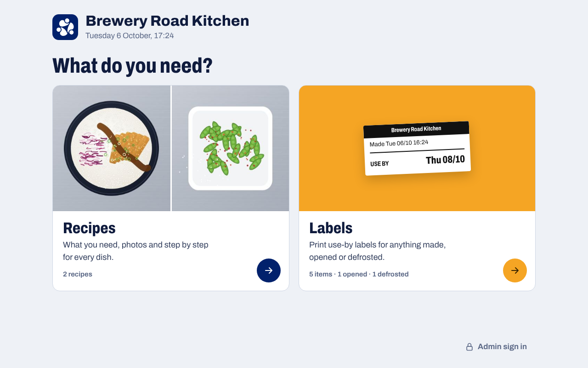
</p>

<p align="center">
  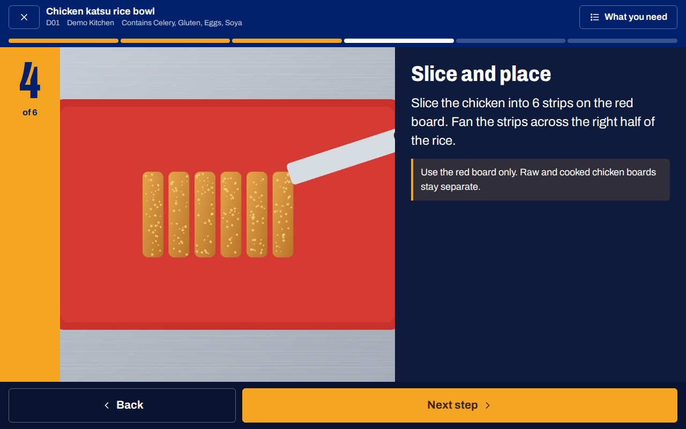
</p>

**Quick start:** download the latest zip from [Releases](https://github.com/MustrHQ/recipes/releases/latest),
upload it to your hosting, open the folder in your browser and follow the installer.
Full details under [Install](#install).

## What it does

Built for delivery-only ("dark") kitchens running several brands from one team, and just as
useful in cafés, bakeries and restaurants. Every cook builds every dish the same way, including
the new starter on their first shift.

**On the kitchen tablet** (no account needed; just the kitchen code, if you set one)

| Screen | What it is |
|---|---|
| Start | "What do you need?": **Recipes** or **Labels**, with today's date and time. Managers sign in to the admin from here. |
| Recipe library | Every dish as a photo tile, grouped by brand. Search by name or ticket code as you type. |
| Recipe page | The finished photo, timings, allergens and diet tags, a safety note, **What you need** and the method. |
| What you need | Every ingredient with its photo and amount. Batch buttons (½× to 4×) scale the amounts; tap to tick an ingredient off. |
| Step by step | One step per screen with a big photo and big text. Back and Next, swipe, or the keyboard. Step timers with an alarm. Ends on the finished photo: "Check it matches the photo". |
| Image preview | Tap any photo: full screen, swipe through every picture, double-tap to zoom. |
| Labels | Pick an item, say when it was made, opened or defrosted, and print its use-by label on a Bluetooth label printer or through the print dialog. |

The screens install as an app on tablets and phones, keep the screen awake while cooking, cache
photos for weak kitchen wifi, and can sit behind an optional kitchen code.

**In the admin panel** (`/admin/`)

| Page | What it is |
|---|---|
| Recipes | Add and edit recipes, with a photo for the dish, each ingredient and each step. Counts for live, hidden and missing photos. Copy, hide, delete. |
| Labels | What can be labelled and for how long, the label size and the printer. |
| Brands | Names, colours and order. |
| Import and export | Recipe packs in and out, with a preview before anything changes, and a ChatGPT brief that writes packs for you. |
| Updates and backups | Install a new release from its zip, with automatic backups and one-click restore. |
| Settings | Kitchen name, kitchen code, admins, your password. |

<table>
  <tr>
    <td>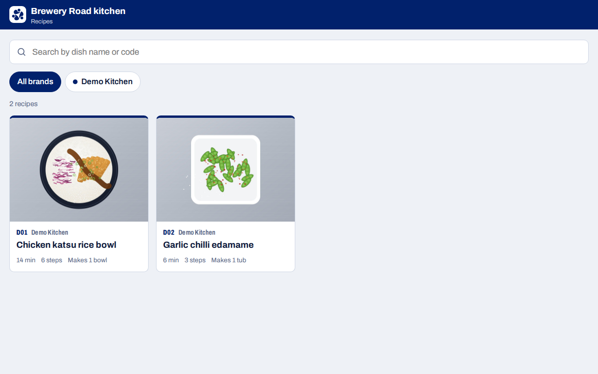</td>
    <td>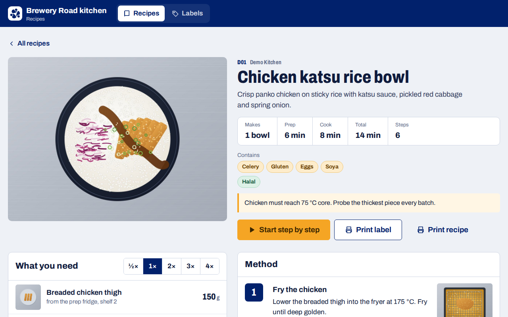</td>
  </tr>
  <tr>
    <td>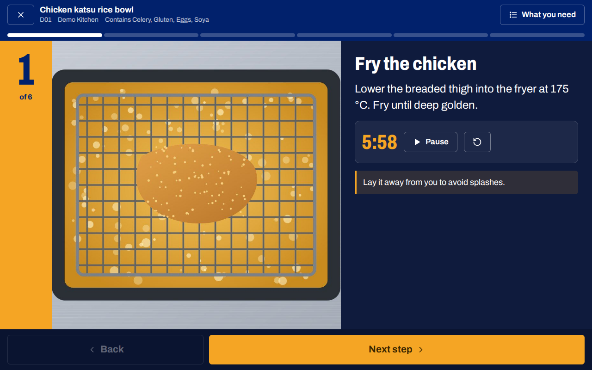</td>
    <td>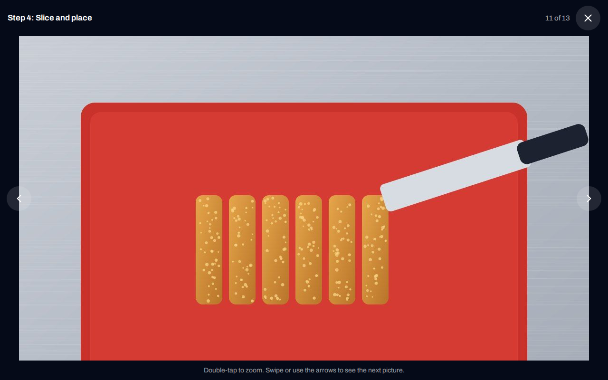</td>
  </tr>
</table>

<table>
  <tr>
    <td>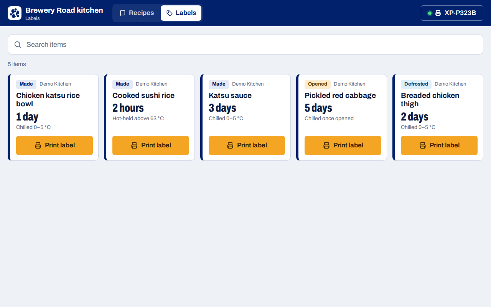</td>
    <td>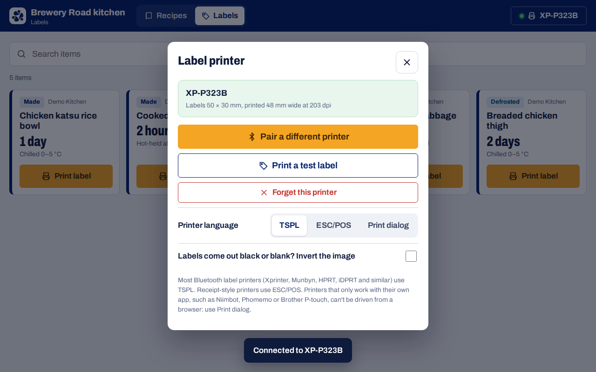</td>
  </tr>
</table>

<p align="center">
  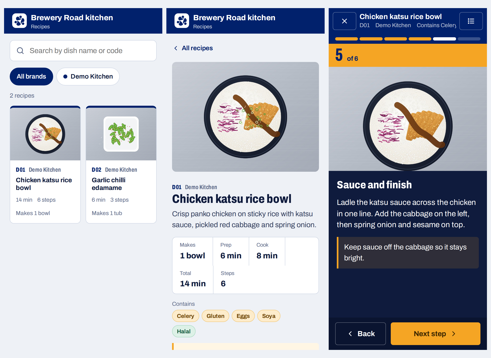
</p>

## Install

1. In cPanel → **MySQL Databases**, create a database and a user, and add the user to the
   database with **All Privileges**.
2. Download `mustrhq-recipes-x.y.z.zip` from [Releases](https://github.com/MustrHQ/recipes/releases/latest)
   and upload it, for example to `public_html/recipes`. Unzip it there.
3. Open `https://your-domain/recipes/` in a browser. The installer opens.
4. **Server check:** PHP version, PDO MySQL, and whether the `uploads` and `backups` folders are
   writable (set them to 755 if not).
5. Enter the database details, your kitchen name, your admin account and, if you want one, a
   kitchen code. Tick **Add two example recipes** to see it working straight away.
6. Press **Delete install.php and sign in**.

The installer writes `config.php` for you. If your host does not allow that, it shows you the
exact file to create.

**Requirements:** PHP 8.1 or newer with PDO MySQL, and MySQL 5.7+ or MariaDB 10.3+. Optional:
the GD extension (resizes big photos on the server) and the zip extension (import, export and
one-click updates). Most cPanel hosts have all of these.

### On the kitchen tablets

Install the screens as an app on each tablet:

- **Android:** open the address in Chrome and tap **Install app** on the start screen card (or ⋮ → Install app).
- **iPad:** open it in Safari, then Share → **Add to Home Screen**.

The app opens full screen on the start screen, the same way as the MustrHQ Rota kiosk, has a shortcut straight to **Labels**, keeps the screen
awake during step by step, and keeps photos for when the kitchen wifi drops. Android's **App
pinning** and iPad's **Guided Access** lock a tablet to it. Admin → Settings has the same guide.

## Use-by labels

<p align="center">
  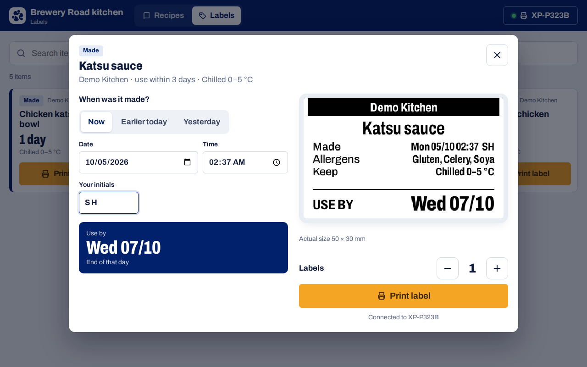
</p>

**Admin → Labels** lists what your team labels: dishes, sauces, prepped veg, anything opened or
defrosted. Each item has a shelf life in **days** or **hours**, a storage line and its allergens.
Link an item to a recipe and the recipe gets a **Print label** button. **Add labels for every
recipe** does that for all of them in one go.

On the tablet, **Labels** shows every item with its photo and shelf life, so the team can spot it quickly. Photos are only on the screen, never on the printed label. Add one in **Admin → Labels**; items linked to a recipe use the recipe's photo. Tap **Print label**, choose *Now*,
*Earlier today* or *Yesterday* (or any date and time), add your initials, and the screen shows the
use-by date and the exact label before it prints.

- **Days:** the day it was made counts as day 1. Made Monday with a 3-day life: use by Wednesday.
- **Hours:** from the time it was made. Rice made at 11:40 with 2 hours: use by 13:40.
- **Supplier's date:** for opened products you can ask for the date on the pack; the label uses
  whichever is sooner.

### Label printers

Labels default to **50 × 30 mm, printed 48 mm wide at 203 dpi**, and are drawn at the printer's
real resolution, so the preview is exactly what prints. Change the size in **Admin → Labels**.

- **Bluetooth:** on the Labels screen tap the printer button → **Connect Bluetooth printer** → print
  a test label. The tablet remembers the printer and reconnects by itself.
- **Printers:** most Bluetooth thermal label printers speak **TSPL** (Xprinter, Munbyn, HPRT, iDPRT
  and similar); receipt-style printers speak **ESC/POS**. If labels come out black or blank, tick
  **Invert**.
- **Browsers:** Bluetooth needs Chrome or Edge (Android, Windows, Mac, ChromeOS) and an `https://`
  address. On iPad, labels print through the print dialog (AirPrint).
- **Not supported:** printers that only work with their own app (Niimbot, Phomemo, Brother P-touch).
  Use the print dialog with them where you can.

## Writing recipes

Each recipe has:

- a **code** that matches the ticket or menu number, so staff can search for it,
- a **finished photo**, shown on the recipe and at the end of step by step,
- **ingredients** for one batch, as prepped items from the fridge. Keep amounts as plain
  numbers so the kitchen can scale them,
- **steps**, one clear action each, with a photo where seeing it helps, a timer where the cook
  has to wait, and a tip for anything that could go wrong,
- the **allergens** the finished dish contains, from the 14 UK allergens, and diet tags.

Photos can be any size. The browser shrinks them to 1800 px before uploading, so they fit
shared-hosting upload limits and load quickly on the tablets.

## Getting recipes from ChatGPT

**Admin → Import and export** builds a whole menu in one go:

1. **Download the brief.** It includes your brands, the allergen keys, a house photo style and
   the exact file format. Optionally paste the menu first.
2. Attach the brief to a new ChatGPT chat and say *"Follow the attached brief"*. It replies with
   a recipe pack: `recipes.json` plus the photos it names.
3. **Import the pack.** You see every recipe (new or replacing an existing one) and any problems,
   such as missing photos or an allergen it did not recognise, before anything is saved.

To improve recipes you already have, export them, attach the export and the brief to ChatGPT, and
ask it to improve them. Codes stay the same, so the import updates them instead of making copies.

### Moving from MustrHQ Station

Station's recipe export and its ChatGPT `mustrhq-pack.zip` import here as they are, with every
recipe and picture:

- recipes go to their brand by code, and brand colours come across;
- ready items become ingredients, with their pictures (`component__p01.png`);
- picture file names such as `katsu-and-co__k01__preview.png` and `__step3.png` are placed on the
  dish and the right step;
- `recipes-part1.json`, `recipes-part2.json`… in one zip are merged;
- quantities like "1 cutlet (180 g raw)" are split into amount, unit and note;
- Station's packing, quality and chef notes and the utensils go into the recipe note.

Big packs are fine. The file is sent to the server in parts, so it can be larger than your
hosting's upload limit, and the import runs a few recipes at a time with a progress bar. A picture
shared by many recipes is stored once. Importing again updates the same recipes instead of copying
them.

**Always check the allergens yourself before a recipe goes live.** The format is documented in
[docs/recipe-pack.md](docs/recipe-pack.md).

<p align="center">
  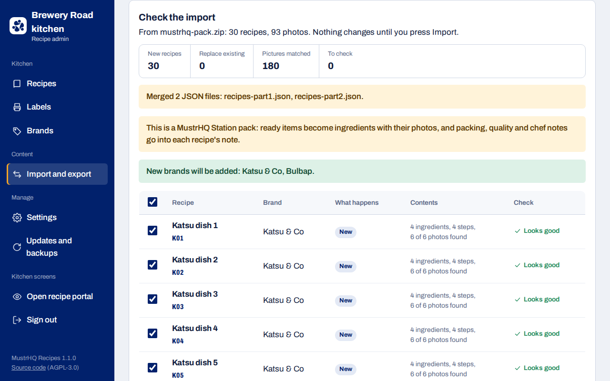
</p>

## Updating

**Admin → Updates and backups.** Press **Check now** to ask GitHub for a newer version and
download it there and then, or upload the release zip yourself. Either way you see what will
change, then:

1. the current app files and the database are backed up,
2. the new files are written (if anything fails, the old version is put straight back),
3. any database upgrades run.

Your recipes, photos and `config.php` are never touched. **Restore** puts back any earlier app
files backup. **Back up now** saves the database, the photos and the app files; download them now
and then and keep them off the server.

You can also update by uploading the new files over the old ones in File Manager. The database
upgrades itself on the next page load.

## Files

```
recipe.php           recipe page
index.php            start screen: Recipes or Labels
recipes.php          recipe library
cook.php             step-by-step mode
labels.php           use-by labels
unlock.php           kitchen code screen
install.php          installer (deleted after use)
manifest.php, sw.php installable app and photo caching
offline.html         shown when the tablet loses the internet
version.php          the release number, read by the updater
admin/               admin panel
assets/              CSS, JavaScript, Archivo font (SIL OFL), icons, logo
inc/                 shared code, database schema and upgrades, demo recipes
uploads/             recipe photos (scripts are blocked here)
backups/             update and manual backups (not served)
docs/                recipe pack format; screenshots for this page
tests/smoke.sh       installs into a fresh database and loads every screen
```

## Security

- Passwords use PHP's `password_hash`. Sign-in and kitchen-code guessing is limited per address.
- CSRF tokens on every form, prepared statements for all SQL, escaped output everywhere.
- A strict Content Security Policy: no inline scripts and nothing loaded from other sites.
  Fonts and icons are bundled; the app never phones home.
- Photos are checked as real images and renamed; `uploads/` refuses to run scripts. `config.php`,
  `inc/` and `backups/` are not served.
- Updates are read as data, checked for unsafe paths and backed up before anything is written.
- The app only connects to the internet when an admin presses **Check now** for updates.

Please serve it over HTTPS (free with AutoSSL in cPanel). Report security problems privately:
see [SECURITY.md](SECURITY.md).

## Design

Navy `#01216C` and amber, the same as the rest of MustrHQ. Archivo, a variable typeface with a
width axis: condensed weights for the big step numbers, normal width for reading. Touch targets
of at least 44 px, text sized to read at arm's length, and the step photo given most of the
screen, because that is what a cook glances at.

## Contributing

Bug reports, ideas and pull requests are welcome. Read [CONTRIBUTING.md](CONTRIBUTING.md) first:
the short version is plain PHP, no build step, and test on a tablet.

## Licence

[GNU AGPL-3.0](LICENSE). You can run it, change it and share it. If you run a changed version
for other people over a network, you must share your changes under the same licence.

The Archivo typeface is by the Archivo Project Authors under the
[SIL Open Font License](assets/fonts/OFL.txt).
